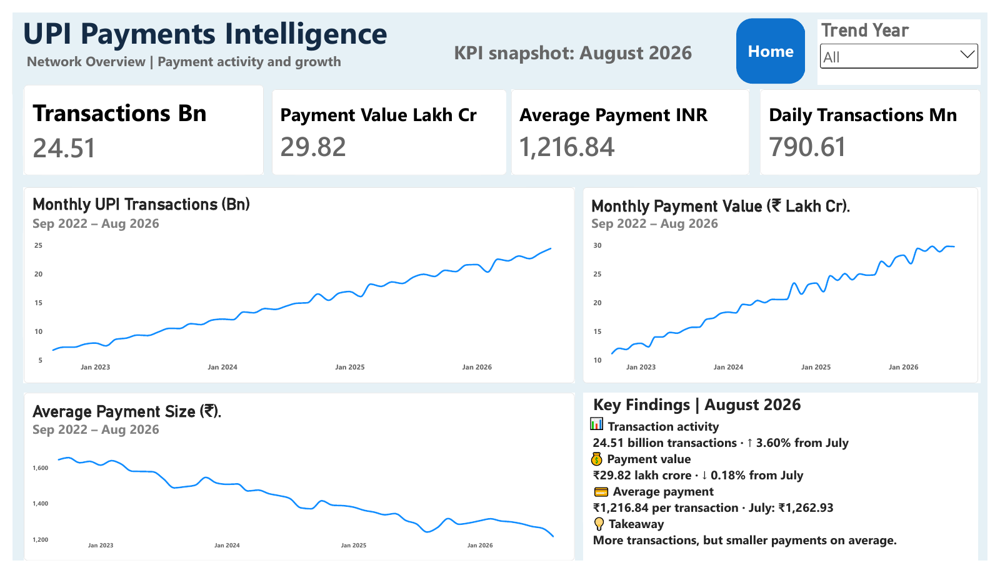
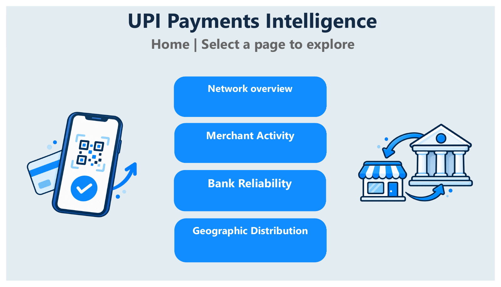
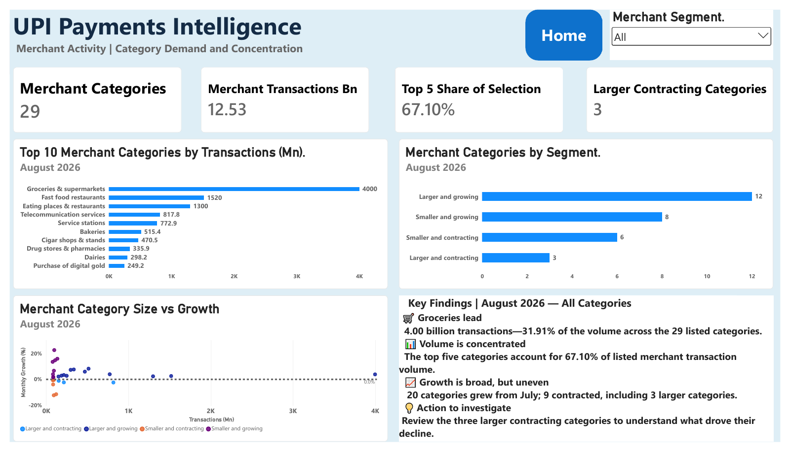
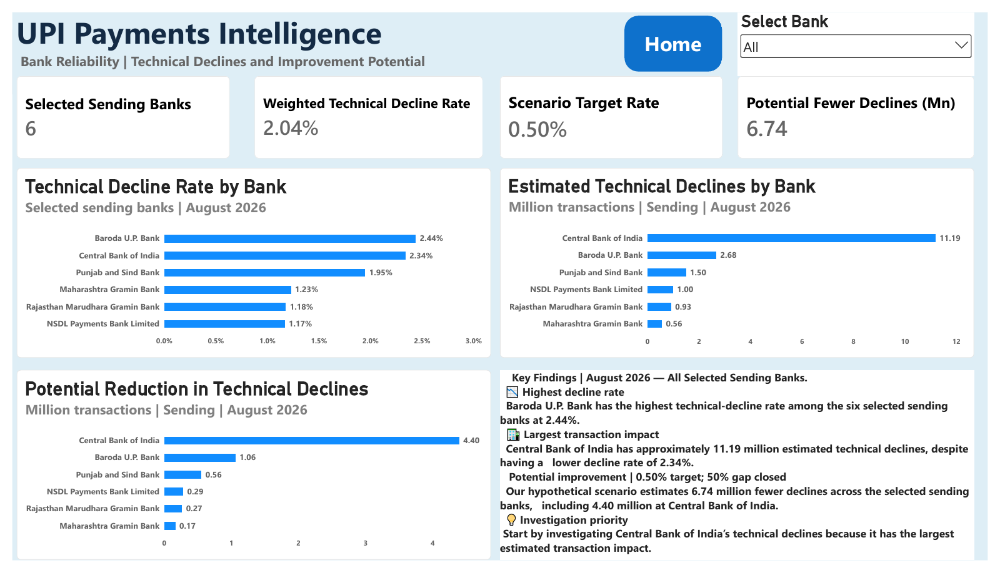
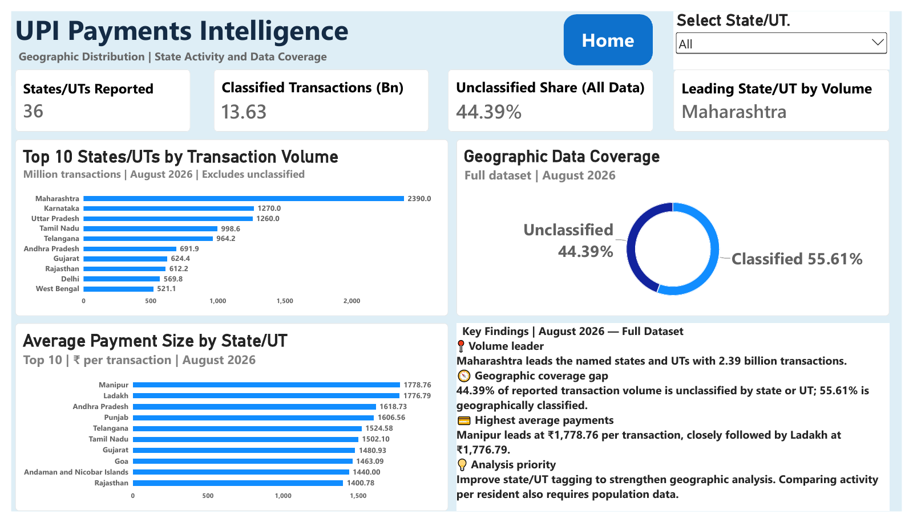

# UPI Payments Intelligence

**From payment data to operational questions.**

An end-to-end analytics portfolio by [Dhananjay1718](https://github.com/Dhananjay1718), exploring India's Unified Payments Interface (UPI): how payment activity changes, where merchant volume concentrates, and which bank and geographic signals deserve investigation.

**Python · pandas · NumPy · SQL · MySQL · Power BI · DAX · Excel**

[**View the dashboard PDF**](reports/UPI_Payments_Intelligence_Dashboard.pdf) · [**Download the Power BI file**](powerbi/UPI_Payments_Intelligence.pbix?raw=true) · [**Explore the findings**](#what-the-analysis-found)

[](reports/UPI_Payments_Intelligence_Dashboard.pdf)

*A saved view of the completed report. The PDF and screenshots can be viewed without installing Power BI.*

| Report | Historical coverage | SQL analysis | Python validation |
|---|---|---|---|
| 5 connected pages | 48 national months | 15 questions with saved answers | 12 checks passed |

## Start here

| What would you like to do? | Open this | What you need |
|---|---|---|
| See the finished work | [Five-page dashboard PDF](reports/UPI_Payments_Intelligence_Dashboard.pdf) | A browser or PDF reader |
| Use slicers and page navigation | [Download the PBIX](powerbi/UPI_Payments_Intelligence.pbix?raw=true) | Power BI Desktop on Windows |
| Inspect the Python workflow | [Executed notebook](notebooks/01_guided_analysis.ipynb) · [Pipeline](src/pipeline.py) | GitHub for reading; Python to rerun |
| Compare SQL questions and answers | [Q01–Q15 SQL](sql/analysis_queries.sql) · [Saved CSV results](reports/sql_results/) | GitHub for reading |
| Explore the spreadsheet scenario | [Download the Excel workbook](reports/UPI_Payments_Intelligence.xlsx?raw=true) · [Sheet previews](reports/excel_previews/) | Excel or a compatible app for editing |
| Reproduce the analysis | [Run locally](#run-locally) · [Folder guide](docs/FOLDER_GUIDE.md) | Python 3.10+ |

**Need help opening a file?** Use the [viewing and download guide](docs/VIEWING_GUIDE.md). A hosted interactive Power BI link will be added after deployment; the downloadable PBIX is the current interactive version.

## Background

UPI (Unified Payments Interface) is India’s interoperable bank-payment system. This portfolio uses published monthly aggregates to study payment activity, merchant concentration, selected-bank technical declines and geographic reporting coverage. It connects analytical results to operational investigation priorities.

## The business question

Where should a payments operations team investigate changing demand, technical declines and gaps in reporting coverage? The analysis connects national trends with three narrower views: listed merchant categories, a selected bank sample and reported state/UT aggregates.

## What the analysis found

These results describe the **August 2026 snapshot**, with national trends covering **September 2022–August 2026**. They are not live statistics.

| Finding | Evidence | Business implication |
|---|---|---|
| More payments, smaller average amounts | 24.51 billion payments; volume +3.60% versus July; transferred value -0.18%; average payment ₹1,216.84 | Investigate payment mix and capacity, rather than treating volume growth as revenue growth |
| Merchant volume is concentrated | The top five of the 29 listed categories account for 67.10% of their combined volume | Prioritize monitoring of high-volume categories; review the three larger contracting categories |
| The highest decline rate is not the largest estimated impact | Baroda U.P. Bank has the highest rate, 2.44%; Central Bank of India has approximately 11.19 million estimated declines | Start operational investigation with affected volume as well as the percentage rate |
| A scenario can guide investigation, but is not an achieved result | A 0.50% target and 50% closure of the excess-rate gap imply 6.74 million fewer declines across six selected sending banks | Treat this as a planning assumption to test against operational evidence |
| Geographic completeness limits interpretation | 44.39% of reported state-table volume is Unclassified | Improve state/UT attribution before making geographic comparisons |

Bank results cover a **selected sample**, not all UPI banks. Merchant shares use only the **29 listed categories**. These distinctions determine what the findings can support.

## Recommended action

**Prioritize investigating Central Bank of India within the six selected sending banks.** It has the largest estimated technical-decline volume in this sample: approximately **11.19 million attempts** in August 2026. Its 2.34% decline rate is below Baroda U.P. Bank’s 2.44%, demonstrating why affected volume matters alongside rates.

Request incident logs, response-code breakdowns and time-of-day failure rates to identify where the excess declines occur. Establish a baseline, test a targeted intervention, and compare decline rates at comparable traffic levels. The 0.50% target and 50% gap-closure scenario guide planning; they are not achieved improvements or verified service targets.

## SQL monitoring extension

[Two anomaly-monitoring queries](sql/anomaly_monitoring.sql) flag unusual daily-normalized volume changes and changes in average payment size. Each compares a month with its **six preceding monthly changes**, excluding the current month from its baseline. Flags require both a deviation above three baseline standard deviations and a five-percentage-point gap. These configurable screening thresholds are not statistically calibrated alerts.

[Interpretation and saved results](docs/ANOMALY_MONITORING.md) explain the assumptions. Aggregate flags prompt investigation; they do not identify fraudulent payments. The original 15 SQL analyses remain unchanged.

## Explore the report

| Page | What it answers |
|---|---|
| [Home](reports/screenshots/01-home.png) | How do I navigate to the four analytical pages? |
| [Network Overview](reports/screenshots/02-network-overview.png) | How have national payment volume, value and average payment changed? |
| [Merchant Activity](reports/screenshots/03-merchant-activity.png) | Which categories dominate, and how does category size relate to reported growth? |
| [Bank Reliability](reports/screenshots/04-bank-reliability.png) | Which selected sending banks have the largest estimated technical-decline impact? |
| [Geographic Distribution](reports/screenshots/05-geographic-distribution.png) | Which states lead the reported activity, and how much volume lacks attribution? |

<details>
<summary>See all five report pages</summary>

### Home



### Network Overview


### Merchant Activity



### Bank Reliability



### Geographic Distribution



</details>

The [native Power BI report](powerbi/UPI_Payments_Intelligence.pbix), five-page PDF and matching PNGs are included. Open the PBIX in Power BI Desktop for interaction. The original PBIX is preserved byte for byte; its saved source paths may need updating to your local `data/processed` folder before refresh. The [Power BI guide](powerbi/BUILD_GUIDE.md), CSVs, theme and documented DAX also support rebuilding the report. `Measures.dax` is equivalent rebuild logic, not an extraction of the compressed native model.

## Data and analytical scope

**126 aggregate fact rows** comprise 48 national months, 29 merchant category rows, 12 bank-role rows and 37 geographic rows. They describe published aggregates; they are not individual transaction records.

| Dataset | Coverage | Grain |
|---|---|---|
| National activity | 48 months, Sep 2022–Aug 2026 | One month |
| Merchant activity | 29 listed categories, Aug 2026 | One category and month |
| Bank reliability | Six displayed banks per role, Aug 2026 | One bank, role and month |
| Geography | 36 named states/UTs plus Unclassified, Aug 2026 | One state/UT and month |

The documented Power BI model uses seven tables, with one-to-many, single-direction relationships from `dim_month`, `dim_merchant` and `dim_bank` to the relevant facts. Different fact tables are not joined directly. See the [relationship map](powerbi/BUILD_GUIDE.md#2-relationships).

## Technical work

- **Python / pandas / NumPy:** parse reported units, validate keys and rates, preserve unavailable comparisons, calculate growth and weighted metrics, segment merchants, and export clean facts and dimensions.
- **SQL:** 15 documented questions using joins, CTEs, `LAG`, window aggregates, ranking and conditional aggregation. Both a seeded MySQL 8 import and an offline SQLite database are included.
- **Power BI:** five pages, DAX measures, Top N charts, a category scatter plot, slicers, controlled visual interactions, fixed snapshot cards and page-navigation buttons.
- **Excel:** six sheets covering an overview, an editable decline scenario, monthly history, merchants, the bank sample and geography; formulas and saved sheet previews are included.
- **Reproducibility:** source identifiers, snapshot dates, raw-file hashes and 12 automated tests covering the original business checks and source-extraction dates.
- **Optional forecasting exercise:** three one-month-ahead baselines evaluated with a chronological validation/test split. This is a notebook extension, not a fifth analytical dashboard page. See [methodology](docs/METHODOLOGY.md#forecasting-extension).

## Run locally

Download and extract the repository ZIP, or clone it:

```bash
git clone https://github.com/Dhananjay1718/UPI-payments-intelligence.git
cd UPI-payments-intelligence
```

Open a terminal in the project root. Use Python 3.10 or newer with the package bounds in `requirements.txt`.

```bash
python -m venv .venv
```

Activate the environment with `.venv\Scripts\Activate.ps1` in Windows PowerShell, or `source .venv/bin/activate` on macOS/Linux. Then:

```bash
python -m pip install -r requirements.txt
python src/pipeline.py
python -m unittest discover -s tests -v
```

The pipeline reads the included snapshots offline and rebuilds processed CSVs, SQLite, 15 SQL result files, metrics and a supplemental Python chart. It does **not** refresh the exported Power BI PDF automatically.

To regenerate the notebook's executed outputs and the MySQL import:

```bash
python src/build_learning_assets.py
```

Open `notebooks/01_guided_analysis.ipynb` with a notebook-capable editor. Jupyter is optional and is not a pipeline dependency.

### MySQL

In MySQL Workbench, run `sql/mysql_import.sql`, which creates the dedicated `upi_portfolio` database. Existing matching rows are refreshed. Run individual question blocks from `sql/analysis_queries.sql` afterward. The user's MySQL work was reviewed during the project; this release's automated query checks run on SQLite, not a MySQL server.

## Repository contents

| Path | Purpose |
|---|---|
| `src/` | Offline pipeline, optional source extraction and notebook/MySQL generation |
| `data/raw/` | Dated source snapshots and extraction manifest |
| `data/processed/` | Analytical facts, dimensions and derived outputs |
| `data/sources.csv` | Source URLs, coverage and precision notes |
| `sql/` | MySQL import, SQLite schema and 15 analytical queries |
| `notebooks/` | Executed Python walkthrough |
| `powerbi/` | Native PBIX, rebuild guide, DAX, Power Query function, theme and Home-page image assets |
| `reports/UPI_Payments_Intelligence_Dashboard.pdf` | Completed five-page report export |
| `reports/screenshots/` | Five PNGs rendered from that exact PDF |
| `reports/sql_results/` | Outputs of the 15 SQL questions |
| `reports/UPI_Payments_Intelligence.xlsx` | Six-sheet Excel workbook with an editable scenario |
| `reports/excel_previews/` | Six saved workbook previews |
| `reports/release_validation.json` | Release checks, including native-file inspection |
| `docs/` | Project guide, Python interview guide, learning path, methodology, contribution record and publishing materials |
| `tests/` | Twelve checks covering units, grain, missingness, SQL, scenarios and extraction dates |

## Optional forecasting exercise

Forecasting remains a supporting learning extension. Three one-month-ahead baselines use 30 months of initial history, six validation months for model selection, and 12 held-out test months. Each prediction uses only earlier observations; the test outcomes do not select the model.

| Baseline | Validation WAPE | Test WAPE | Test MAE (million transactions) |
|---|---:|---:|---:|
| Last-month daily rate | 1.91% | 1.66% | 363.96 |
| Last-year daily rate | 25.44% | 20.45% | 4,491.84 |
| 12-month log-linear trend (selected) | 1.59% | 1.12% | 247.05 |

The trend baseline reduces test WAPE by approximately **32.1% relative to the last-month daily-rate baseline**, on this frozen data vintage. This small 12-month test does not establish future accuracy. The September 2026 estimate of 23.99 billion is a historical exercise using data through August; the assumed ±10% scenarios are not prediction intervals. See [methodology](docs/METHODOLOGY.md#forecasting-extension) and [saved metrics](data/processed/forecast_metrics.csv).

## Glossary

| Term | Meaning in this project |
|---|---|
| UPI | Unified Payments Interface |
| Mn / Bn | Million / billion; 1 Bn = 1,000 Mn |
| Crore / lakh crore | 10 million / 1 trillion; value figures here are INR |
| Average payment / ticket | Total transferred value divided by transaction volume |
| MoM / YoY | Change versus the preceding month / same month a year earlier |
| Technical decline (TD) | A payment attempt declined for a technical reason; not evidence of fraud |
| Weighted TD rate | Total estimated technical declines divided by total attempts within the selected bank role |
| WAPE | Sum of absolute forecast errors divided by sum of actual volumes |
| MAE | Mean absolute forecast error, expressed in the target’s units |
| Investigation flag | A screening-rule result requiring contextual review |

## Study materials

- [Project and learning guide](docs/UPI_Project_Guide.pdf): the original 12-page project companion.
- [Python interview preparation](docs/UPI_Python_Interview_Preparation_Guide.pdf): 28 pages covering the programs, explanations, outputs and interview questions.
- [Learning path](docs/LEARNING_PATH.md): exercises and interview checkpoints, updated for the completed report.
- [Complete file inventory](docs/FILE_INVENTORY.md): where every final deliverable lives and how the earlier guides relate to the finished report.

The two PDFs preserve their original learning-stage content. Use the current README and Power BI guide for the finished five-page design.

## Sources and limitations

The source register records a **22 September 2026 retrieval date**:

- **S1:** [NPCI monthly statistics](https://www.npci.org.in/product/upi/product-statistics), supplying the five official monthly overrides for April–August 2026.
- **S2:** [India Dispatch monthly series](https://data.indiadispatch.com/payments/upi-transactions), attributing NPCI, for the displayed 48-month history. The latest five months are replaced by the S1 values after a tolerance check.
- **S3:** [India Dispatch payments tables](https://data.indiadispatch.com/payments), attributing NPCI, for the displayed August merchant, bank and state tables.

Historical and detailed secondary-source values are rounded. The state rows sum to 24,509.40 million versus the official national 24,508.96 million; the 0.44 million difference is retained and documented. Dashboard coverage shares use the state-row total; SQL Q12 also shows the comparison against the official national total. Both round to 44.39% Unclassified.

Technical declines are **not fraud labels**. This project does not establish fraud prevented, revenue recovered, customer churn, bank failure root causes or measured operational savings. Sending and receiving observations must not be added as independent payments. The scenario target is an analyst assumption, not an NPCI standard.

## Project ownership and validation

The author built the Power BI report locally, worked through Python and MySQL results, and refined filters, titles, KPI formats and navigation. AI assisted with code, explanations, design ideas, graphics, troubleshooting and documentation. See [the contribution record](docs/MY_CONTRIBUTION.md) for the evidence and scope.

The five-page PDF was visually reviewed on 7 October 2026. The 9 October folder review reran the pipeline, all 12 tests, nine notebook code cells and both study-guide generators from a path containing spaces. All 30 generated CSVs and the headline summary matched the packaged analytical results. On 8 October 2026, the supplied PBIX passed ZIP integrity checks and read-only inspection confirmed five pages, eight valid navigation destinations, Sending/August filters on all eight bank data visuals, the fixed August network cards and the state-slicer exclusion for the coverage donut. Runtime refresh and native DAX were not executed here; see the [review notes](docs/REPORT_REVIEW.md).

## Feedback

Questions about the analysis or suggestions for clearer reporting are welcome through [GitHub Issues](https://github.com/Dhananjay1718/UPI-payments-intelligence/issues). For background on the author's work, see the [contribution record](docs/MY_CONTRIBUTION.md) or [GitHub profile](https://github.com/Dhananjay1718).
